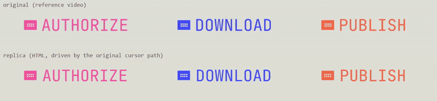
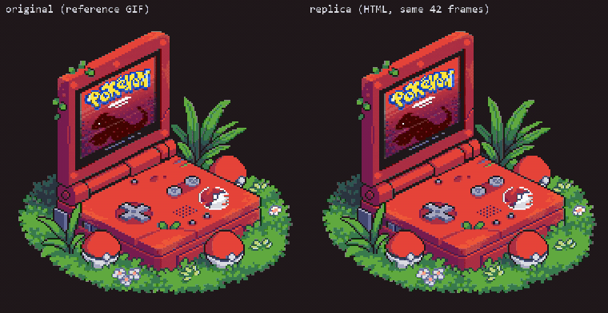
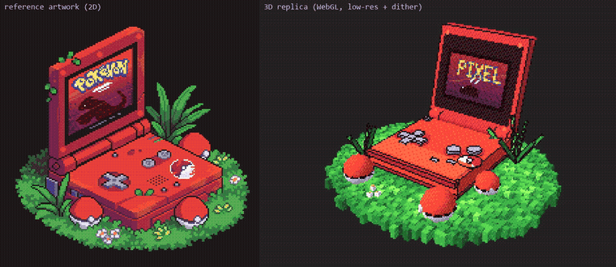

# Examples: references vs replicas

Three small reproduction jobs done with the engine, each with the **reference**, the **replica** (a self-contained HTML page)
and a **comparison video**. Everything here was produced and checked in this repository's workflow; numbers below are measured, not claimed.

> The reference materials (`*/ref/`) are third-party artwork / screen recordings included only for side-by-side comparison; their rights belong to their authors. Open an issue if you are a rights holder and want something removed.

| Example | Reference | Replica | Comparison video | How it was checked |
|---|---|---|---|---|
| `hover-buttons/` | `ref/hover-buttons-reference.mp4` (3840x2108, 60 fps, 17.75 s) | `index.html` (3 hover buttons, clickable) | `compare_original_vs_replica.mp4` (original on top, replica below, same cursor path) | 13 of 13 hover events reproduced, onset/offset error median 58 ms, p95 133 ms, max 167 ms (`timing.json`) |
| `gba-2d/` | `ref/reference.gif` (42 frames, 10 fps) | `index.html` (frame-exact replay + clickable console buttons) | `compare_gif_vs_replica.mp4`, `demo_buttons.mp4` | 0 differing pixels over all 42 frames |
| `pixel-3d/` | `ref/reference_frame.png` (frame 0 of the GIF) | `index.html` (three.js, pixel look, orbit + clickable buttons) | `compare_ref_vs_3d.mp4` | visual only: it is a stylised 3D take, not a copy |

## What the engine did here
- `analysis/*.txt`: the engine's funnel summary of each reference (`ve summary`): 17.75 s of 4K video and the 42-frame GIF.
- `hover-buttons/`: cursor path (`cursor_path_tip.json`), fill-edge curves (`curves/`), per-button dot figures and timings were all measured from the reference (see the page's comments).
  Fitted from the reference: the hover hit area is the filled box plus ~28 px sideways / ~10 px vertically (this is what makes all 13 hover events appear in the replica).
- `gba-2d/`: only 4% of the pixels change in the GIF (screen and a small LED); the replica stores just those regions per frame.

## Honest limits
- The hover-buttons replica video is rendered by a canvas mirror of the page's state (same state machine and tween code, fake clock), not a screen capture of the DOM. Text anti-aliasing differs slightly from a real browser.
- The cursor in the replica row is not drawn: the page is driven by the measured cursor path.
- `pixel-3d` shows its own screen content (not the artwork's logo); geometry and button positions were set by eye.
- Before the hit-area padding was fitted, 2 of the 6 DOWNLOAD hovers were missed in the replica (and one spurious short hover appeared); AUTHORIZE and PUBLISH already matched.

## Re-recording
`recording/` has the frame server and the three in-page recorders (run them in a browser console on the served page).
See `recording/README.md`.
